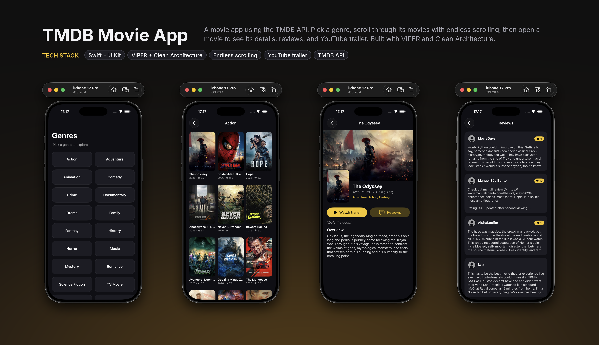

# Mandiri TMDB

iOS assessment project using the TMDB API, built with VIPER + Clean Architecture. Pick a genre, browse the movies with endless scrolling, then tap a movie to see its details, trailer, and user reviews.

## Features

* Movie genre list
* Movies by genre with endless scrolling
* Movie detail with YouTube trailer
* User reviews with endless scrolling
* Loading, empty, and error states

## Tech stack

* Swift + UIKit
* VIPER + Clean Architecture
* Moya (Alamofire) with async/await
* Kingfisher for image loading and caching
* UICollectionView and UITableView with custom cells
* WKWebView for the trailer
* TMDB API

## Dependencies

Installed with Swift Package Manager:

* [Moya](https://github.com/Moya/Moya)
* [Alamofire](https://github.com/Alamofire/Alamofire)
* [Kingfisher](https://github.com/onevcat/Kingfisher)

## Screenshot

  

